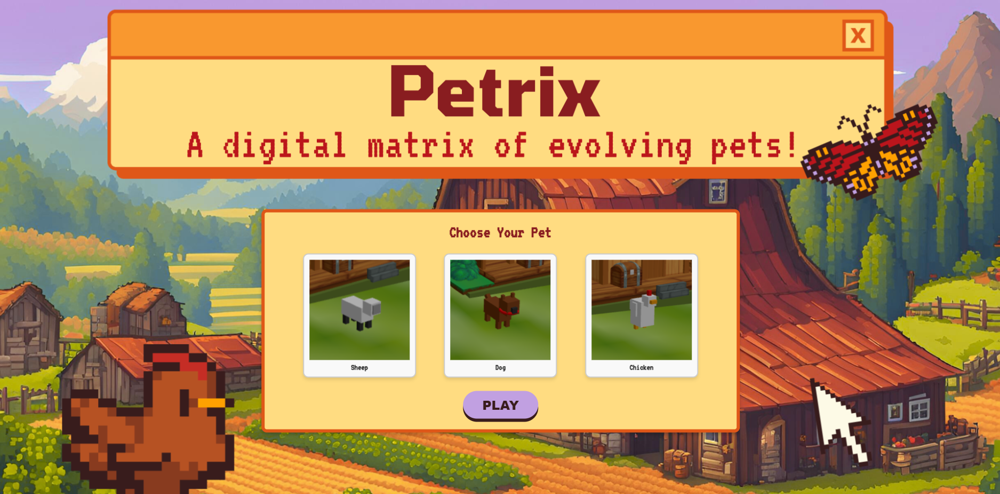
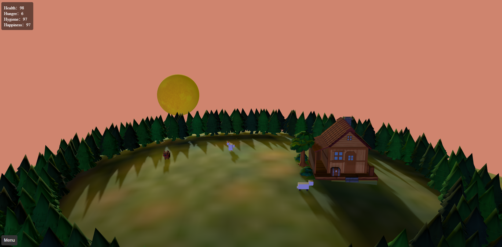
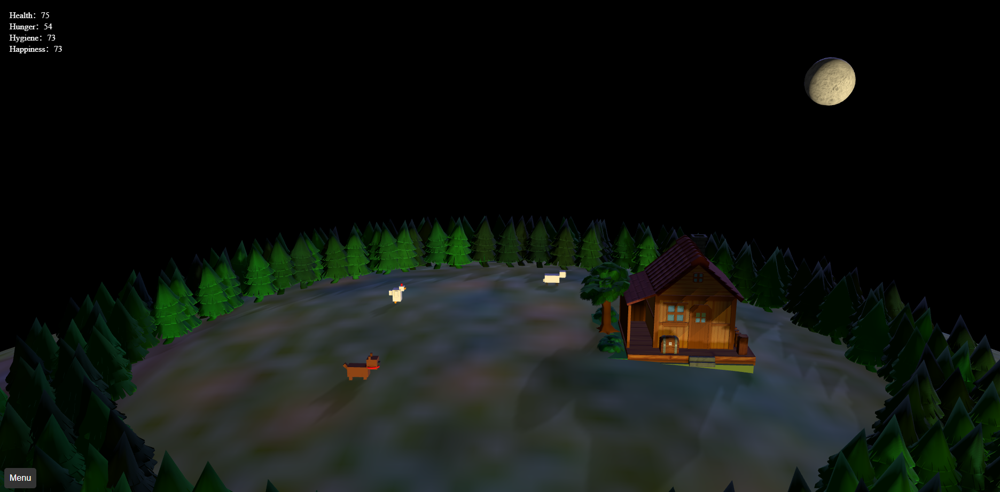

# Petrix — A Digital Pet Matrix

An interactive 3D virtual pet simulation built with **Three.js and JavaScript**. Choose a sheep, dog, or chicken, explore a miniature world, and care for your pet while the other animals move autonomously.



## Features

- **Pet care:** Feed, clean, and play with your selected pet. Life, hunger, hygiene, and happiness change over time, with visual indicators for unmet needs.
- **Movement and animation:** Control your pet with the keyboard while unselected animals perform randomized actions.
- **Collision handling:** Bounding boxes separate animals and keep them out of the house; a debug view exposes collision bounds.
- **Animated environment:** Orbiting celestial bodies, changing background colors, and moving directional lights create a day/night cycle.
- **Graphics:** Custom shader code, textured objects, shadows, and imported glTF scenery.
- **Camera controls:** Orbit the scene or attach the camera to an orbiting object.

The autonomous animals use programmed randomized behavior; this project does not train a machine-learning model.

## Run locally

Install Node.js compatible with Vite 5 (Node 18+), then run:

```bash
git clone https://github.com/smalex-z/Petrix.git
cd Petrix
npm ci
npm run dev
```

Open the local URL printed by Vite, usually **http://localhost:5173**. No backend, database, or account is required. Use a browser with WebGL support.

Dependencies are already declared in `package.json` and pinned in `package-lock.json`; no project initialization is needed.

## Controls

| Input | Action |
| --- | --- |
| Pet selection screen | Choose the animal you control |
| W / A / S / D | Move the selected pet |
| Mouse and scroll wheel | Orbit and zoom using the scene camera controls |
| Interaction menu | Feed, clean, or play with your pet |
| Backtick (`) | Toggle bounding-box visualization |
| 3 / 4 | Attach the camera to one of the orbiting objects |
| 0 | Restore the default camera |




## Project structure

```text
JS/
  globalVar.js      Shared scene, renderer, camera, and pet state
  setup.js          Pet selection, scenery, and bounding boxes
  sheep.js          Sheep model
  dog.js            Dog model
  chickens.js       Chicken model
  movement.js       Keyboard movement and randomized actions
  status.js         Pet needs and status display
  icons.js          Needs indicators
  planets.js        Celestial objects and orbital transforms
  lighting.js       Lighting and background transitions
  shaders.js        Custom shader definitions
  cameraControl.js  Camera attachment and reset
  house.js          Cabin loading and collision bounds
  utils.js          Matrix transformation helpers
assets/             Styles, images, textures, and glTF models
docs/               Project screenshots and verification notes
main.js             Interaction handlers and animation loop
index.html          Browser entry point
```

## Development and verification

| Command | Purpose |
| --- | --- |
| `npm run dev` | Run the local Vite server |
| `npm run build` | Bundle the application into `dist/` |
| `npm run preview` | Preview an existing build |

See [verification notes](docs/verification.md) for runtime checks and asset-path limitations. The existing `npm test` command is a placeholder, not an automated test suite.

## Team and assets

Developed as a collaborative UCLA CS 174 project. Individual contributions are recorded in the repository history.

The cabin is **Stardew valley Cabin** by **MoebiousII**. Its source, attribution, and CC-BY-NC-4.0 terms are preserved in the [included asset license](assets/stardew_valley_cabin/license.txt). Imported artwork retains its own licensing terms.
